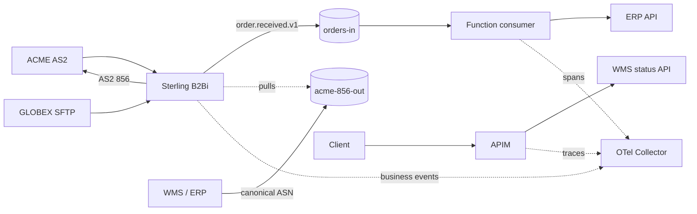

# Case 01: Onboard ACME (EDI/AS2), then GLOBEX (SFTP file) with the accelerator

Worked example showing how the patterns, templates, and onboarding generator fit together.
Target times below are goals to measure against, not measured results.

## Scenario
- **ACME Retail** sends EDI **850** purchase orders over **AS2** and expects an **856** ASN back.
  Orders must reach the ERP; shipment status must be queryable by API.
- **GLOBEX Distribution** can only drop CSV order files on **SFTP**. Their orders must reach the same ERP.

## Patterns used
| Flow | Pattern | Doc |
|---|---|---|
| ACME 850 -> ERP | 2. Async command | `patterns/02-async-command.md` |
| ACME status lookup | 1. Sync request-reply | `patterns/01-sync-request-reply.md` |
| ACME ASN -> 856 | 5. API-to-EDI | `patterns/05-api-to-edi.md` |
| GLOBEX CSV -> ERP | 4. File-to-API (joins pattern 2) | `patterns/04-file-to-api.md` |

## Architecture


## Part A: onboard ACME

1. **Issue:** open a "Partner onboarding" issue; record the start time.
2. **Manifest:** `manifests/partners/partner-acme.yaml` already describes AS2, documents 850 (in) and 856 (out), queue `orders-in`, backend ERP, SLA 15 minutes.
3. **Validate and generate:**
   ```bash
   python scripts/onboard_partner.py manifests/partners/partner-acme.yaml --check
   python scripts/onboard_partner.py manifests/partners/partner-acme.yaml --out generated
   ```
4. **Review the package** in `generated/ACME/` (a committed copy lives in `docs/cases/generated-example/ACME/`):

   | File | What it gives you |
   |---|---|
   | `partner.parameters.json` | Creates outbound queue `acme-856-out` via `templates/bicep/partner-onboarding.bicep` |
   | `apim-named-values.json` | Backend URL and AS2 certificate as Key Vault references |
   | `observability.yaml` | SLA, DLQ, and failed-event alerts plus dashboard tiles |
   | `sterling-setup-checklist.md` | Human steps: AS2 profile, certificate, maps, BPs |
   | `test-plan.md` | Happy path, duplicate, malformed, 503, DLQ replay, SLA drill |
5. **Azure side (pipeline, DEVL):** deploy the per-partner queue; confirm `orders-in` exists; apply the APIM policy from `templates/apim/get-operation-policy.xml`.
6. **Sterling side (human):** build the BPs from `templates/sterling/bp-850-inbound.md` and `bp-856-outbound.md`, follow `partner-profile-checklist.md`, export and commit resources.
7. **Test:** run `test-plan.md` with `contracts/examples/order.example.json` and `asn.example.json`.
8. **Verify telemetry:** one `correlationId` links APIM -> Sterling events -> Service Bus -> Function -> ERP, and the 856 reuses the order's `correlationId`.
9. **Sign off** and record the end time and manual steps on the issue.

## Part B: onboard GLOBEX (the accelerator test)

1. Copy `partner-acme.yaml`, change protocol to SFTP, one inbound 850, `pattern: file-to-api` (already in `partner-globex.yaml`).
2. Run the same two commands. Review `generated/GLOBEX/`.
3. **What is reused unchanged:** `orders-in`, the Function consumer, the ERP call, the alerts model, the test-plan structure.
4. **What is new:** an SFTP account and paths, a CSV-to-canonical map, and a file-level BP (parse, per-order correlation ids, `batchId`, archive, stale-file alert).
5. **Measure:** record how long this takes against ACME. The difference is the accelerator's value.

## Scorecard to fill in
| Metric | ACME | GLOBEX |
|---|---|---|
| Elapsed time, manifest to go-live | | |
| Files changed in repo (excluding generated) | | |
| Manual Sterling steps | | |
| Defects found in test | | |
| Steps that could be automated next | | |

## What to improve after this case
- Move the Bicep template into `infra/modules/` and compile it in CI.
- Have the pipeline run the generator and deploy from the manifest (issue 9).
- Add Pattern 3 (pub/sub) templates when a second consumer appears.
- Promote repeated Sterling steps into exported, parameterized BP templates.
