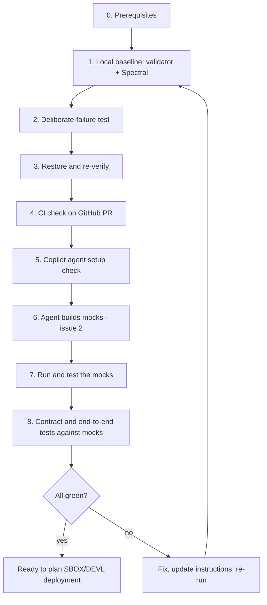

# Mock Testing Workflow (End to End)

Place this file at `docs/mock-testing-workflow.md` in `sterling-b2bi-api-poc`.

Purpose: prove, before any Azure or Sterling dependency, that the scaffold, CI gates, Copilot coding agent, and mock-based tests all work, and that failures are actually detected.

## Overview



## 0. Prerequisites

| Item | Needed for |
|---|---|
| Git, Python 3.10+ | Local validator |
| Node 20+ (optional) | Spectral, Prism mocks |
| GitHub CLI `gh` (optional) | Creating labels and issues |
| Repo pushed to GitHub, Actions enabled | CI and Copilot agent |

Resource needs are small: under about 1 GB of free RAM covers everything in steps 1 to 4.

## 1. Local baseline

```bash
git clone https://github.com/<you>/sterling-b2bi-api-poc.git
cd sterling-b2bi-api-poc
pip install jsonschema pyyaml
python scripts/validate_contracts.py
echo $?
```

Expected: every line starts with `OK`, and the exit code is `0`.

Optional OpenAPI lint:

```bash
npm install -g @stoplight/spectral-cli
spectral lint "contracts/openapi/*.yaml" --ruleset .spectral.yaml
```

Warnings are possible (the specs have not been linted in advance). Fix them in a PR, or relax a rule in `.spectral.yaml` if it is noise.

## 2. Deliberate-failure test (prove the check can fail)

A check that has never failed is not proven. Break one thing, run the validator, confirm the failure, then restore.

| Break | File | Expected result |
|---|---|---|
| Delete `"poNumber"` line | `contracts/examples/order.example.json` | `FAIL ... 'poNumber' is a required property` |
| Change `type: AS2` to `type: FTP` | `manifests/partners/partner-acme.yaml` | `FAIL manifest partner-acme.yaml` |
| Change `"quantity": 100` to `"100"` | `contracts/examples/order.example.json` | `FAIL` (wrong type) |
| Change `"orderDate"` to `11/25/2026` | `contracts/examples/order.example.json` | `FAIL` (bad date format) |

```bash
# example: remove poNumber (Mac/Linux)
sed -i.bak '/"poNumber"/d' contracts/examples/order.example.json
python scripts/validate_contracts.py
echo $?      # expect 1
```

## 3. Restore and re-verify

```bash
git checkout contracts/examples/order.example.json
rm -f contracts/examples/*.bak
python scripts/validate_contracts.py
echo $?      # expect 0
```

## 4. Confirm CI on GitHub

1. Create a branch and repeat one break from step 2:
   ```bash
   git checkout -b test-break-validator
   # make the break, then:
   git commit -am "Test: break order example"
   git push -u origin test-break-validator
   ```
2. Open a pull request. In **Checks**, expect these jobs:
   - `contracts` -> **red** (shows the same FAIL lines)
   - `openapi-lint`, `bicep` (passes trivially: "No Bicep files yet"), `secret-scan`
3. With branch protection and "require status checks" on, the merge button should be blocked.
4. Close the PR without merging and delete the branch.

Known catch: `secret-scan` uses gitleaks, which needs a `GITLEAKS_LICENSE` secret on organization-owned repos. If it fails for that reason, add the license or switch to GitHub's built-in secret scanning.

## 5. Copilot coding agent setup check

- [ ] Settings -> Copilot -> Coding agent is enabled
- [ ] Firewall allowlist includes registries (registry.npmjs.org, api.nuget.org, pypi.org, files.pythonhosted.org)
- [ ] `copilot-setup-steps.yml` is on the default branch and runs cleanly (Actions -> run manually)
- [ ] Branch protection on `main`; CODEOWNERS handles replaced with real ones
- [ ] Label and issues created:
  ```bash
  gh label create agent-task
  ./scripts/create-issues.sh <owner>/sterling-b2bi-api-poc
  ```

## 6. Agent builds the mocks (issue 2, the pilot)

1. Assign issue 2 ("Mocks for ERP order API and WMS status API") to Copilot.
2. Review the PR it opens:
   - [ ] Branch name starts with `copilot/`
   - [ ] Only files under `/tests` changed
   - [ ] `/contracts` untouched
   - [ ] Workflow run approved by you; CI green
   - [ ] PR description explains how it was tested
3. If the agent went out of bounds or guessed wrong, tighten `.github/copilot-instructions.md` and `.github/agents/test-agent.agent.md`, then re-run.

## 7. Run and test the mocks

The exact start command depends on what the agent built (docker compose or an npm script). With Prism the default port is 4010; use the port shown by the actual command.

```bash
# WMS status: expect 200 with orderId, status, updatedAt
curl -i http://localhost:4010/orders/123/status \
  -H "x-correlation-id: 7b1f6c52-3a4e-4d3b-9f0a-2c9d8a1e5b77"

# ERP create order: expect 201 (or 200 for a duplicate)
curl -i -X POST http://localhost:4010/orders \
  -H "Content-Type: application/json" \
  -H "x-correlation-id: 7b1f6c52-3a4e-4d3b-9f0a-2c9d8a1e5b77" \
  -d @contracts/examples/order.example.json
```

Checks:
- [ ] Status mock returns 200, and 404 for an unknown id (if configured)
- [ ] ERP mock accepts the example order
- [ ] A request missing `x-correlation-id` is rejected (required by the spec)
- [ ] Smoke test from the PR passes

## 8. Contract and end-to-end tests against the mocks

As issues 5, 6, and 8 merge:

| Test | Passing looks like | Proof it can fail |
|---|---|---|
| APIM -> WMS mock contract test | Response matches `wms-status.v1.yaml` | Rename a field in the spec; test goes red |
| Function -> ERP mock contract test | Request matches `erp-orders.v1.yaml` | Same |
| Idempotency | Same `(partnerId, docType, controlNumber)` sent twice -> one order | Send twice; second is ignored or returns 200 |
| DLQ path | Forced ERP 503 -> message dead-lettered with `correlationId` | Point the Function at a failing mock |
| Correlation | One `x-correlation-id` seen at every hop | Strip the header at one hop; test goes red |

Revert any deliberate spec change after the check (`git checkout <file>`).

## 9. Exit criteria (ready to plan SBOX / DEVL deployment)

- [ ] Validator, Spectral, and Bicep build green on `main`
- [ ] Each check shown to fail when deliberately broken
- [ ] Mocks run from one command and pass their smoke test
- [ ] Contract tests and the correlation-ID end-to-end test pass against mocks
- [ ] All PRs human-reviewed and merged; ADR-001 moved from "Proposed" to "Accepted"
- [ ] Contracts reviewed against the real ERP and WMS APIs (mocks only prove self-consistency)

## Troubleshooting

| Symptom | Likely cause | Action |
|---|---|---|
| Edit still prints `OK` | File not saved, or wrong directory | Save; run from the repo root (folder containing `scripts/`) |
| CI job fails on a file you did not touch | Contract or manifest does not match its schema | Read the validator output; it names the field |
| Agent produces no PR | Not assigned to Copilot, firewall blocking a registry, or setup steps failing | Check assignment, allowlist, and the `copilot-setup-steps` run |
| Workflow runs stay "waiting" on agent PRs | Approval gate working as designed | Approve the run from the PR |
| Spectral warnings on first run | Specs were not linted ahead of time | Fix in a normal PR or tune `.spectral.yaml` |

## Not covered here

Azure deployment, Sterling B2Bi, and the OpenTelemetry Java agent are out of scope for mock testing. They begin when you promote to SBOX/DEVL.
