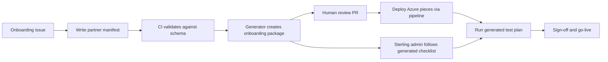

# Partner Onboarding Accelerator

Goal: onboarding a new trading partner is a manifest change plus a reviewed pipeline run, not a project.

## Flow


## Steps
1. Open an issue with the **Partner onboarding** template.
2. Copy an existing manifest in `manifests/partners/` and edit it (no secrets; only Key Vault secret names).
3. Validate and generate:
   ```bash
   python scripts/onboard_partner.py manifests/partners/partner-<id>.yaml --check
   python scripts/onboard_partner.py manifests/partners/partner-<id>.yaml --out generated
   ```
4. Review `generated/<ID>/` and open a PR with the manifest (and generated package if you commit it).
5. Deploy Azure resources with the pipeline; the Sterling admin follows `sterling-setup-checklist.md`.
6. Run `test-plan.md`, record results in the issue, then go live.

## Choosing the pattern
Set `routing.pattern` in the manifest. See `patterns/README.md` for the decision tree.

## Target
First partner: days. Second partner of the same pattern: hours, with only the partner-specific Sterling work left.
Record the actual elapsed time on each onboarding issue to prove the accelerator works.

## Boundaries
The generator produces reviewable files. It does not call Azure or Sterling, and it never handles secrets.
Sterling configuration is still built by a human from the generated checklist.
