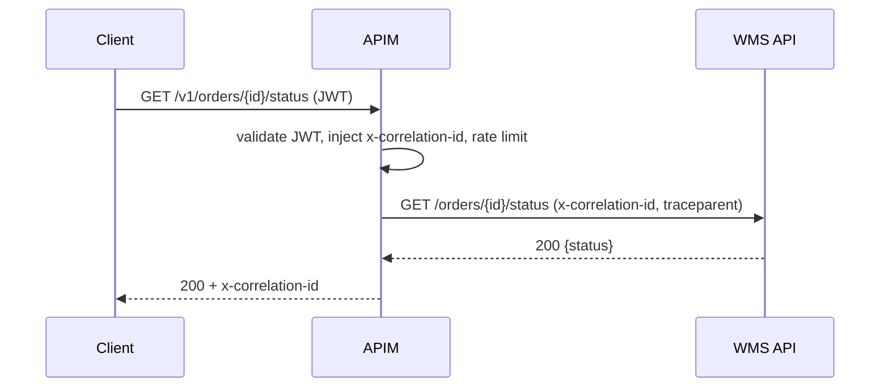

# Pattern 1: Sync request-reply

**Intent:** a caller needs an immediate answer (order status, inventory lookup, shipment tracking).

**Use when:** the backend answers in seconds and a failure can simply be returned to the caller.
**Avoid when:** the work takes long, must not be lost, or must survive a backend outage (use Pattern 2).

## Components
- APIM operation from `contracts/openapi/gateway-orders.v1.yaml`
- Backend: WMS status API (`wms-status.v1.yaml`), mocked in the POC

## Guardrails
- Backend timeout 10 s; return 504 rather than hanging.
- Retry only idempotent GETs, at most once; add a circuit breaker for repeated failures.
- Rate limit per subscription; return 429 with `Retry-After`.
- Cache only non-sensitive, short-lived status (optional).
- Always return `x-correlation-id` so callers can quote it to support.

## Templates
- `templates/apim/get-operation-policy.xml`

## Test checklist
- [ ] 200 with valid token; 401 without; 429 over limit
- [ ] Missing `x-correlation-id` -> gateway generates one and returns it
- [ ] Supplied `x-correlation-id` is preserved to the backend
- [ ] Backend 404 -> 404; backend timeout -> 504
