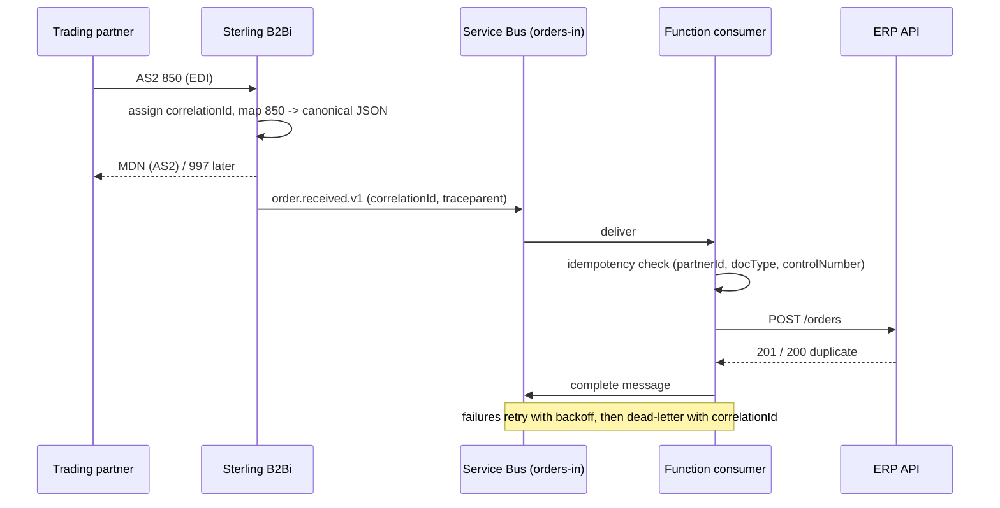

# Pattern 2: Async command (inbound 850 -> ERP)

**Intent:** accept a business document reliably, acknowledge it, and process it later without losing it.

**Use when:** a partner sends a document (850) that must be processed exactly once in effect.



## Components
- Sterling BP template (`templates/sterling/bp-850-inbound.md`)
- Queue `orders-in` (shared; `partnerId` is a message property)
- Function consumer; ERP API (`erp-orders.v1.yaml`)
- Event schema `contracts/events/order-received.v1.schema.json`

## Design decisions
- **Idempotency key:** `(partnerId, docType, controlNumber)`. A duplicate returns success without a second order.
- **Retries:** exponential backoff in the consumer; `maxDeliveryCount` then dead-letter. Never retry forever.
- **Poison messages:** dead-letter reason and `correlationId` must be preserved; replay is a human-approved action.
- **Ordering:** not guaranteed. If a partner needs ordering per PO, use Service Bus sessions keyed on `poNumber`.
- **Large payloads:** store in Blob, send `payloadRef` (see `order.schema.json`).

## Illustrative handler outline (not compiled)
```
onMessage(msg):
    ctx = restoreTraceContext(msg.properties.traceparent, msg.properties.correlationId)
    event = validate(msg.body, order-received.v1.schema)        # dead-letter on schema failure
    key = (event.partnerId, event.docType, event.controlNumber)
    if seen(key): complete(msg); return                         # duplicate, safe
    resp = erp.post("/orders", event.order, headers={correlationId, traceparent})
    if resp.status in (200, 201): markSeen(key); complete(msg)
    elif resp.status >= 500: abandon(msg)                       # retry with backoff
    else: deadLetter(msg, reason="ERP rejected", detail=resp.body)
    emitBusinessEvent("sent" | "failed", partner, docType, poNumber, correlationId)
```

## Test checklist
- [ ] Happy path: one 850 -> one ERP order -> one trace
- [ ] Same control number twice -> one order
- [ ] ERP 503 -> retries -> dead-letter with `correlationId`
- [ ] Malformed payload -> dead-letter, no ERP call
- [ ] Payload > 200 KB -> claim-check path works
