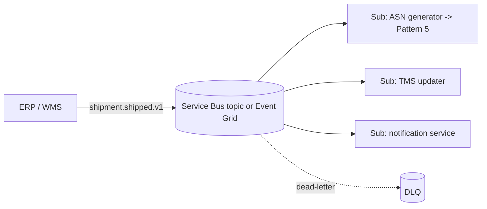

# Pattern 3: Pub/sub event (phase 2)

**Intent:** announce that something happened (order shipped, inventory changed) to any number of
consumers without the producer knowing who they are.

**Use when:** more than one system reacts (WMS, TMS, customer notifications, analytics).
**Avoid when:** exactly one system must perform a specific action (use Pattern 2, a command).

## Design decisions
- Use a Service Bus **topic** when delivery guarantees and DLQ per subscriber matter; Event Grid for
  lightweight reactive notifications; Event Hubs for high-volume streams.
- Events are facts in the past tense, versioned in the name (`shipment.shipped.v1`), and carry
  `correlationId`, `eventTime`, and business keys. Schemas live in `contracts/events/`.
- Each subscriber owns its own idempotency and DLQ handling.
- Never put secrets or full PII in events.

## Templates (to be added)
Topic + subscription Bicep module and an event schema template. Not part of the first POC slice.

## Test checklist
- [ ] One event reaches every subscription
- [ ] A failing subscriber does not block others
- [ ] Schema version bump does not break existing subscribers
