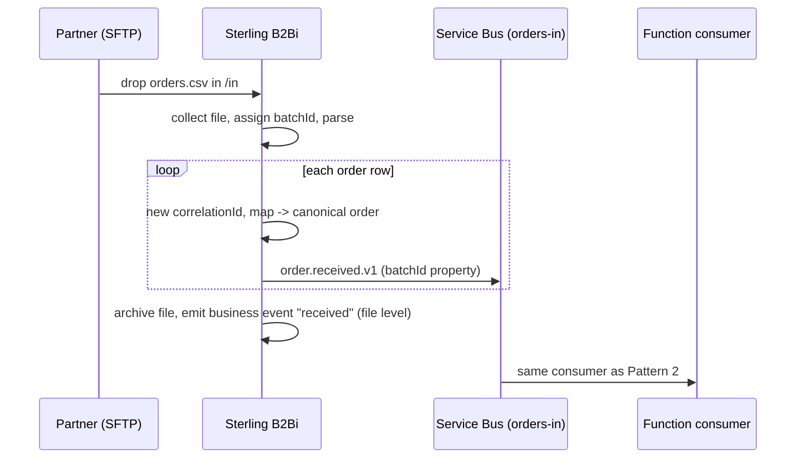

# Pattern 4: File-to-API (SFTP batch -> canonical orders)

**Intent:** partners that only send files (CSV/flat file/XML) feed the same modern pipeline as EDI partners.

**Use when:** the partner cannot send EDI/API. Sterling stays the edge for SFTP.

## Design decisions
- After parsing, the flow **joins Pattern 2**: the consumer and ERP call are identical.
- **Correlation:** one `batchId` per file (span/message attribute) and one `correlationId` per order.
- **Partial failures:** a bad row dead-letters or goes to a reject file; it must not block the batch.
- **File hygiene:** checksum, size limit, expected file-name pattern, archive after success, alert on stale/missing files.
- **Idempotency:** the same file arriving twice must not duplicate orders (use `controlNumber` = file id + row, or a content hash).

## Templates
- `templates/sterling/bp-850-inbound.md` (adapt the receive step to SFTP)
- Manifest example: `manifests/partners/partner-globex.yaml`

## Test checklist
- [ ] 100-row file -> 100 orders, one batch trace
- [ ] One malformed row -> 99 orders + one reject
- [ ] Same file twice -> no duplicates
- [ ] No file by the expected time -> alert
