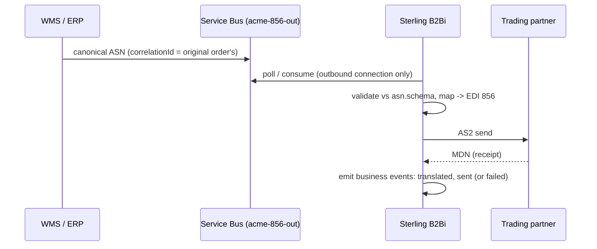

# Pattern 5: API-to-EDI (ASN -> outbound 856)

**Intent:** a modern system (WMS/ERP) emits a business document as JSON; Sterling converts it to EDI
and delivers it to the partner.

## Design decisions
- **Sterling pulls from the queue** (JMS/AMQP or a small bridge). Azure never calls into Sterling, so no
  inbound firewall holes and it works from a sandbox on a private network.
- **One outbound queue per partner and document**: `{partnerId}-{docType}-out` (created by
  `templates/bicep/partner-onboarding.bicep`). Duplicate detection is on.
- **Reuse the order's `correlationId`** in the ASN so one trace covers 850 -> 856.
- **Delivery confirmation:** `sent` is emitted only after the partner's MDN; a missing MDN raises an alert.
- **Retries and resend:** retry with backoff, then dead-letter. Resend from the DLQ is a human-approved action.

## Templates
- `templates/bicep/partner-onboarding.bicep` (outbound queue)
- `templates/sterling/bp-856-outbound.md`
- `contracts/canonical/asn.schema.json`, `contracts/examples/asn.example.json`

## Test checklist
- [ ] ASN JSON -> valid 856 -> partner MDN received -> `sent` event
- [ ] Invalid ASN -> dead-letter, `failed` event, no AS2 send
- [ ] MDN timeout -> retry, then alert
- [ ] Same ASN twice -> one 856 (duplicate detection)
