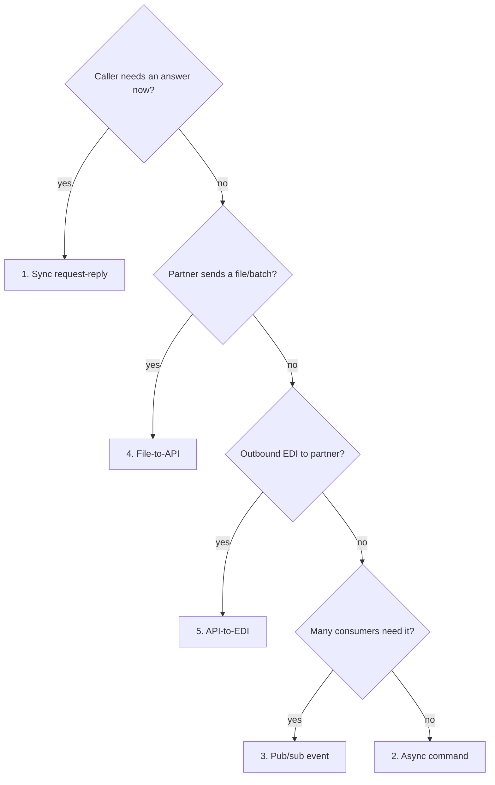

# Integration Pattern Catalog

Reusable patterns for bridging Sterling B2Bi (AS2/SFTP/EDI) with Azure APIs. Every new
partner flow should be an instance of one of these, not a one-off design.

| # | Pattern | Style | Used by | Status in POC |
|---|---|---|---|---|
| 1 | [Sync request-reply](01-sync-request-reply.md) | Synchronous | `GET /orders/{id}/status` | In POC slice |
| 2 | [Async command](02-async-command.md) | Asynchronous | Inbound 850 -> ERP | In POC slice |
| 3 | [Pub/sub event](03-pubsub-event.md) | Asynchronous | Order/shipment events to many consumers | Phase 2 |
| 4 | [File-to-API](04-file-to-api.md) | Async (batch) | SFTP CSV partners (GLOBEX) | Second-partner test |
| 5 | [API-to-EDI](05-api-to-edi.md) | Asynchronous | ASN -> outbound 856 | In POC slice |

## How to choose

## Rules that apply to every pattern
1. One `x-correlation-id` (GUID) end to end; carry W3C `traceparent` alongside it.
2. Idempotent consumers on `(partnerId, docType, controlNumber)`.
3. Every queue has a dead-letter policy and explicit `maxDeliveryCount`.
4. Payloads over 200 KB use the claim-check pattern (Blob + reference).
5. Telemetry attributes: `partner.id`, `doc.type`, `po.number`, `correlation.id`.
6. Secrets only as Key Vault references; never in manifests or code.

## What each pattern ships with
Each pattern lists its **templates** (under `/templates`), **contracts** (under `/contracts`),
and a **test checklist**. The onboarding generator (`scripts/onboard_partner.py`) reads the
`routing.pattern` field of a partner manifest and produces the matching artifacts.
